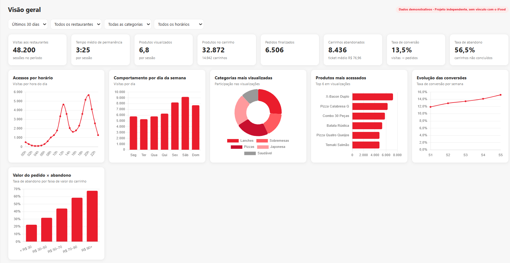
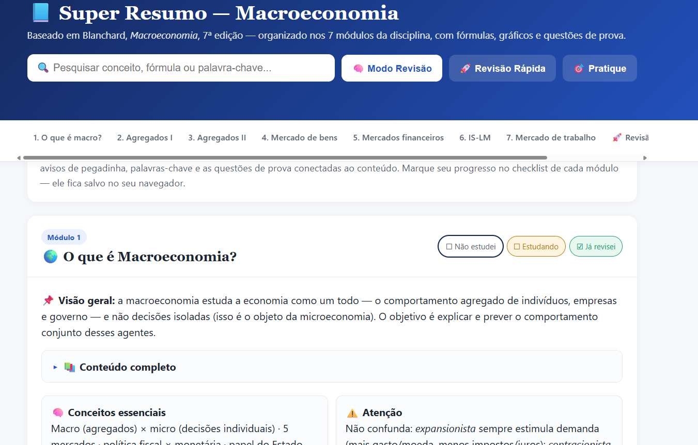
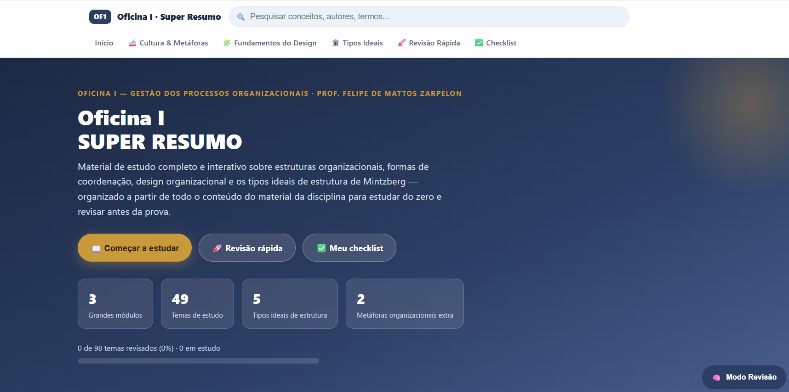

 

## ✦ Olá, eu sou a Isabela! 👋

Sempre fui uma pessoa curiosa, com interesse por diferentes assuntos e vontade de aprender coisas novas. Mas, mesmo gostando de explorar várias áreas, inovação e tecnologia sempre despertaram uma curiosidade especial em mim.

Ao mesmo tempo, gosto muito do contato com as pessoas, de trocar ideias e de entender diferentes perspectivas. Esse interesse me aproximou da área de Recursos Humanos, onde tive a oportunidade de desenvolver minha experiência profissional e conhecer mais sobre o lado humano das organizações.

A comunicação também é algo com que sempre me identifiquei. Gosto de pensar em como as ideias são transmitidas, como as pessoas se conectam e como podemos tornar informações mais claras e acessíveis.

Hoje, como estudante de **Administração na Universidade Federal do Rio Grande do Sul (UFRGS)**, venho descobrindo formas de conectar esses interesses. Tenho explorado ferramentas digitais, análise de dados e inteligência artificial, buscando entender como a tecnologia pode contribuir tanto para os negócios quanto para as pessoas.

Foi dessa vontade de experimentar e aprender na prática que surgiram os projetos que compartilho aqui. 
Mais do que apresentar resultados, este portfólio representa minha curiosidade, meus aprendizados e minha vontade de continuar descobrindo novas possibilidades.

 &nbsp; 

Administração · UFRGS · Escola de Administração

---

## ✦ Projetos em destaque

Projetos que nasceram de desafios, interesses e aprendizados, combinando o olhar da Administração com a experimentação de ferramentas digitais.

### 01 · PULSE — Inteligência sobre o comportamento do consumidor

**Inteligência de negócios · Comportamento do consumidor · Estratégia comercial**

O **PULSE** é um protótipo de inteligência de negócios voltado à jornada de compra no setor de delivery. A proposta é explorar como indicadores podem ajudar a identificar padrões de comportamento, gargalos de conversão e oportunidades comerciais.

Painel do PULSE · Dados demonstrativos

**O que é possível explorar:**

- Indicadores de desempenho e comportamento de navegação.
- Filtros por período, restaurante, categoria e horário.
- Visualizações de acessos, produtos e conversão.
- Simulador de cenários comerciais.
- Assistente de negócios com recomendações simuladas por regras predefinidas.

**O que aprendi:** conectar métricas e hipóteses comerciais à construção de uma interface que facilita a leitura dos dados e a reflexão sobre decisões.

> **Sobre o protótipo:** os dados são demonstrativos. O assistente utiliza respostas simuladas por regras, sem conexão com um modelo de IA em tempo real.

 

---

### 02 · Simulador Acadêmico — Planejamento universitário

**Planejamento acadêmico · Organização de informações · Tecnologia**

**🚧 Projeto em desenvolvimento**

O **Simulador Acadêmico** é uma ferramenta em desenvolvimento para apoiar estudantes na organização da trajetória universitária. A ideia é facilitar a visualização da situação acadêmica e a exploração de possibilidades para os próximos semestres, reunindo informações que costumam estar dispersas em documentos e sistemas.

**O que estou explorando:**

- Organização de disciplinas e informações curriculares.
- Acompanhamento da trajetória acadêmica.
- Simulação de possibilidades de planejamento dos semestres.
- Apresentação mais clara de informações para apoiar escolhas acadêmicas.

**O que estou aprendendo:** transformar uma necessidade vivida no contexto universitário em uma ferramenta prática, considerando clareza, usabilidade e limites da leitura de documentos acadêmicos.

> **Versão em desenvolvimento:** recursos e resultados podem mudar durante os testes e aprimoramentos. As informações apresentadas devem ser conferidas com os canais oficiais da universidade.

 

---

### 03 · Macroeconomia — Plataforma interativa de estudos

**Educação · Organização da informação · Aprendizagem interativa**

Desenvolvi uma plataforma digital para organizar conteúdos de **Macroeconomia** em um ambiente de estudo mais visual e fácil de consultar. A ideia foi ir além de um resumo tradicional, combinando explicações, navegação e recursos de revisão.

Conteúdo por módulos, pesquisa e revisão

**O que é possível explorar:**

- Conteúdos organizados por módulos.
- Pesquisa de conceitos, fórmulas e palavras-chave.
- Recursos de revisão e questões para praticar.
- Acompanhamento do progresso de estudo.

**O que aprendi:** transformar materiais acadêmicos extensos em uma estrutura digital organizada e interativa.

 

---

### 04 · Oficina I — Plataforma interativa de estudos

**Gestão do conhecimento · Organização · Experiência do usuário**

O projeto **Oficina I** surgiu da vontade de transformar materiais da disciplina em um ambiente de aprendizagem estruturado, com navegação por assuntos, recursos de revisão e acompanhamento do progresso.

Ambiente de estudos com navegação e acompanhamento

**O que é possível explorar:**

- Conteúdos organizados por módulos e tópicos.
- Pesquisa de conceitos e navegação temática.
- Checklist e acompanhamento de progresso.
- Recursos de revisão e questões interativas.

**O que aprendi:** organizar conhecimento pensando na experiência de quem utiliza a ferramenta, combinando conteúdo, clareza visual e recursos práticos.

 

---

## ✦ Meus interesses

| Pessoas e negócios | Tecnologia e inovação |
| :--- | :--- |
| Recursos Humanos e desenvolvimento de pessoas | Inteligência artificial aplicada |
| Comunicação e relacionamento | Ferramentas digitais |
| Estratégia e tomada de decisão | Análise e visualização de dados |
| Melhoria de processos | Soluções digitais e experimentação |
| Comportamento do consumidor | Inteligência de negócios |

 

---

## ✦ Como transformo ideias em projetos

**01 · Entender a necessidade** — observar um problema ou uma oportunidade que faça sentido para as pessoas.

**02 · Organizar as informações** — reunir conteúdos, identificar prioridades e pensar na melhor maneira de apresentá-los.

**03 · Experimentar** — explorar ferramentas digitais e recursos de IA como apoio à construção de protótipos.

**04 · Aprender e aprimorar** — avaliar o resultado, reconhecer limitações e buscar melhorias.

 

---

## ✦ Vamos nos conectar?

Gosto de conhecer pessoas, trocar ideias e aprender com experiências diferentes. Tenho interesse em oportunidades que aproximem **Administração, pessoas, comunicação e tecnologia**.

&nbsp;

 

Construindo, aprendendo e explorando novas possibilidades. 🤎

